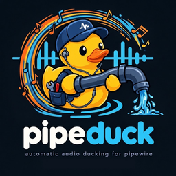

<p align="center">
  
</p>

# PipeDuck

**Automatic audio ducking for PipeWire — for remote calls, your own microphone, or both.**

PipeDuck lowers music, games, videos and other playback while somebody is speaking in a selected
voice-call stream. It can also duck when *you* speak into your microphone, and it always fades back
smoothly to the correct volume instead of jumping.

It is a C++20 reimplementation of [pw-duck](https://github.com/geri1701/pw-duck) with a system-tray
UI, terminal and GTK4 tuners, smooth volume ramps and microphone-triggered ducking.

[](https://github.com/ErRusso/pipeduck/actions/workflows/ci.yml)
[](LICENSE)

## Features

- **Call ducking** — detects speech in a selected voice-call playback stream.
- **Microphone ducking** — detects when you speak into a selected microphone.
- **Call or microphone** — trigger on either source, with per-source VAD.
- **Smooth fades** — configurable fade-down and fade-back times; the return to 100% volume is a
  real smoothstep ramp instead of an abrupt jump.
- **Tray control** — StatusNotifierItem/SNI tray icon with live status, source/mic selection,
  trigger selection, tuning and an on/off switch. Left-click toggles ducking; right-click opens
  the full configuration menu. Playback streams are grouped by application and microphones by
  device, and the menus refresh automatically as streams appear or disappear.
- **Live tuners** — terminal (`pipeduck tune`) and GTK4 (`pipeduck tune-gui`), with separate
  sensitivity for call audio and the microphone.
- **Config hot reload** — changes from either tuner apply to a running tray immediately.
- **Event-driven** — one libpulse subscription keeps the stream list current without polling
  `pactl`; fades run on the control tick, so new speech interrupts a return fade immediately.
- **Safe routing** — temporary virtual sink, automatic stream restore, and a safety fallback that
  leaves the sink alive rather than terminating application audio. Ducking follows default-output
  changes and never overwrites the user's default sink when it stops.
- **Single instance** — a second tray instance refuses to start.
- **CLI** — status, stream discovery, source/mic selection and diagnostic routing.

## Requirements

- PipeWire with a session manager (WirePlumber recommended)
- PulseAudio compatibility (`pactl` must work; provided by `pipewire-pulse`)
- `pw-link` from PipeWire
- A StatusNotifierItem/SNI tray host
- GTK4 only for the graphical tuner

KDE Plasma supports SNI natively. GNOME needs an AppIndicator/KStatusNotifierItem extension.
`ashell`, Waybar, XFCE, Cinnamon and most other bars work as well.

### Build dependencies

| Distribution | Packages |
| --- | --- |
| Arch Linux | `base-devel cmake pkgconf pipewire libpulse json-c glib2 gtk4 ncurses` |
| Debian/Ubuntu | `build-essential cmake pkg-config libpipewire-0.3-dev libpulse-dev libjson-c-dev libglib2.0-dev libgtk-4-dev libncurses-dev` |
| Fedora | `gcc-c++ cmake pkgconf pipewire-devel pulseaudio-libs-devel json-c-devel glib2-devel gtk4-devel ncurses-devel` |

The GTK4 package is optional; build with `-DPIPEDUCK_GUI=OFF` to omit the graphical tuner.

## Install

### From source

```bash
cmake -S . -B build -DCMAKE_BUILD_TYPE=Release
cmake --build build -j"$(nproc)"
sudo cmake --install build
```

The install places `pipeduck`, a desktop entry, hicolor icons and a man page under the usual
prefixes. To install into your home directory:

```bash
cmake --install build --prefix "$HOME/.local"
```

## Quick start

1. Join a voice call so its playback stream exists.
2. Start the tray:

   ```bash
   pipeduck
   ```

3. Right-click the tray icon, then choose **Source: choose** → the stream that contains call
   audio.
4. Choose a trigger under **Trigger**:
   - **Call audio** — duck when remote participants speak.
   - **My microphone** — duck when you speak.
   - **Call audio or microphone** — either one.
5. Choose **Microphone: choose** if you use microphone-triggered ducking.
6. Enable **Ducking**.
7. Open **Tuner: open** if you want to adjust sensitivity, volume, hold time or fades.

On first use, the defaults are: duck to 25%, hold 700 ms, fade down in 80 ms and fade back in
320 ms.

## Commands

```text
pipeduck                 # start the tray (default)
pipeduck tray            # start the tray explicitly
pipeduck status          # default sink, streams, trigger and current tuning
pipeduck sources         # list playback streams selectable as call audio
pipeduck select-source 5 # save a playback stream by sink-input index
pipeduck mic-sources     # list microphones
pipeduck select-mic 64   # save a microphone by index or name
pipeduck tune            # terminal tuner
pipeduck tune-gui        # GTK4 tuner, if built with GUI support
pipeduck route           # route and duck until Ctrl+C (changes the live graph)
pipeduck route-once --seconds 5
pipeduck config-path     # print the config path
pipeduck init-config     # create a default config
```

`route` and `route-once` intentionally require `--yes-really-route` because they modify the live
PipeWire graph:

```bash
pipeduck route --trigger both --yes-really-route
```

If `sources` shows a stream as `#546`, pass only the number:

```bash
pipeduck select-source 546
```

### Common options

```text
--duck-percent N     volume for other audio while speech is active (0-100)
--vad-threshold F    base RMS threshold for call audio; speech starts above roughly 2x this value
--mic-vad-threshold F  base RMS threshold for the microphone (defaults to --vad-threshold)
--hold-ms N          stay ducked for N ms after speech stops
--fade-ms N          smooth return time in ms (overrides release_fade_ms)
--trigger MODE       call, mic or both
```

## Configuration

Settings live in:

```text
~/.config/pipeduck/config.toml
```

Example:

```toml
duck_percent = 25
vad_threshold = 0.0100
mic_vad_threshold = 0.0250
hold_ms = 700
attack_fade_ms = 80
release_fade_ms = 320
trigger = "both"

[voice_source]
label = "Discord / discord / playStream"
application_name = "WEBRTC VoiceEngine"
application_process_binary = "discord"
media_name = "playStream"
media_class = "Stream/Output/Audio"

[mic_source]
name = "alsa_input.usb-Microphone-00.pro-input-0"
label = "USB Microphone"
```

| Key | Meaning |
| --- | --- |
| `duck_percent` | Target volume for non-call audio while speech is active. |
| `vad_threshold` | Base RMS threshold for call audio. `0.0025` is very sensitive, `0.2` disables detection. Speech has to exceed about twice this value to start and 0.75x to stay active. |
| `mic_vad_threshold` | Optional microphone-specific RMS threshold. When omitted or unset, `vad_threshold` is used, so older configs behave exactly as before. |
| `hold_ms` | How long ducking stays active after speech falls silent. |
| `attack_fade_ms` | Fade-down duration. `0` disables the fade. |
| `release_fade_ms` | Fade-back duration. `0` restores volume instantly. **This is the smooth-return control.** |
| `trigger` | `call`, `mic` or `both`. |
| `voice_source` | Optional voice-call stream to exclude from ducking. Routing follows the current default output. |
| `mic_source` | Optional microphone. When unset, the default microphone is used. |

The configuration schema is compatible with pw-duck's `config.toml`; missing new keys receive the
defaults above.

## How it works

While ducking is enabled, PipeDuck creates a temporary `support.null-audio-sink` through PipeWire.
Its monitor ports are linked to the playback ports of the current default sink. Every playback
stream on that sink — except the configured call stream — is moved to the virtual sink. A single
libpulse subscription keeps the sink, source and stream lists current, so routing and the tray
menus react to changes without spawning `pactl`. If the default output changes while ducking is
active, the session is restarted against the new device.

The selected call stream stays on the real sink and is captured with a PipeWire stream
(`stream.capture.sink=true`). Microphone mode captures the selected source instead. Both feeds are
analyzed for RMS energy and passed through hysteresis-based voice activity detection with an attack
time, a release threshold and a configurable hold time.

The virtual sink's monitor volume is controlled directly through libpulse. Instead of switching
between two values, PipeDuck walks a smoothstep curve in small steps:

```text
speech active:   100% ──fade down──▶ duck_percent
speech stops:    duck_percent ──hold──▶ smoothstep ──▶ 100%
```

This is what makes the return to the correct volume sound smooth instead of like a jump. The fade is
advanced by the control loop rather than blocking it, so speech detected during a return fade
immediately cancels the upward ramp and fades back down from the current volume.

On shutdown, streams are moved back to their original sinks, monitor links are removed and the
virtual sink is destroyed. PipeDuck does not restore the default sink, because the user may have
switched outputs while ducking was active. If a stream cannot be moved away safely, the virtual sink
is deliberately left alive so that active application audio is not terminated.

## Tuning

- **Sensitivity (call)** — how easily speech in the call stream is detected. `0%` disables
  detection, `100%` is very sensitive. Internally this maps to `vad_threshold`.
- **Microphone sensitivity** — a separate threshold for microphone-triggered ducking, mapped to
  `mic_vad_threshold`. It falls back to the call sensitivity when unset.
- **Ducking volume** — volume for non-call audio while speech is active.
- **Hold** — delay before the return fade starts after speech stops.
- **Duck fade** — how quickly audio fades down when speech starts.
- **Return fade** — how gently audio returns to full volume.
- **Trigger** — call, microphone, or either.

Both tuners write to `config.toml` on every change, and a running tray picks the changes up within
a few hundred milliseconds.

## Microphone mode

Microphone-triggered ducking monitors your actual microphone input. This works with any application,
including games and browsers that do not expose a separate call stream.

> **Tip:** use headphones. If your microphone picks up the speakers, ducked playback can re-trigger
> the detector and keep the volume low.

If the configured microphone disappears, PipeDuck falls back to the default microphone and reports
it in the tray tooltip.

## Troubleshooting

### No tray icon

- On GNOME, install and enable an AppIndicator/KStatusNotifierItem extension.
- Verify the SNI host is running: `busctl --user status org.kde.StatusNotifierWatcher`.
- Restart PipeDuck. If a tray host cached the old icon, restarting the host also helps.

### No call stream appears

- Join a call first; many applications only create a playback stream while audio is active.
- Run `pipeduck sources` and select the stream containing call audio.
- Some apps use separate streams for voice and sound effects. Selecting the WEBRTC/voice stream is
  usually correct.

### Ducking does not react

- Check the selected source or microphone.
- Increase sensitivity, or lower `vad_threshold`.
- Make sure sensitivity is not `0%` and the trigger matches the source you selected.
- Run `pipeduck status` and watch the tray details while speaking.
- For microphone mode, verify `pipeduck mic-sources` lists the intended device.

### Volume does not return to 100%

- Check `release_fade_ms`; `0` means instant, larger values mean a longer ramp.
- Run `pipeduck status` and inspect whether "Voice inactive" appears in the tray.
- If a stream stayed on a leftover `pipeduck-*` sink after an abnormal exit, move it back with:
  ```bash
  pactl list sink-inputs short
  pactl move-sink-input <index> <your-sink>
  ```

## Development

```bash
cmake -S . -B build -DCMAKE_BUILD_TYPE=Debug
cmake --build build -j"$(nproc)"
ctest --test-dir build --output-on-failure
```

Format the sources with:

```bash
clang-format -i $(git ls-files 'src/*.cpp' 'include/*.hpp' 'tests/*.cpp')
```

Regenerate the application, symbolic and tray icons after editing the master logo:

```bash
python3 -m pip install pillow
scripts/generate-icons.py
```

The unit tests cover TOML parsing, identity matching, VAD hysteresis, port pairing, Pulse JSON
parsing and the volume-ramp curve. An optional integration test against a live local PipeWire
session is described in [CONTRIBUTING.md](CONTRIBUTING.md).

## Differences from pw-duck

- Written in C++20 with CMake instead of Rust/Cargo.
- Microphone-triggered ducking with a `call`/`mic`/`both` trigger mode.
- Smoothstep fades in both directions; the return volume is no longer a hard switch.
- Volume ramps use libpulse's asynchronous API rather than spawning `pactl` for every step.
- Native GDBus StatusNotifierItem/DBusMenu implementation.
- Same virtual-sink routing model, safe teardown behavior and TOML configuration style.

## Credits

PipeDuck is based on [pw-duck](https://github.com/geri1701/pw-duck) by
[Gerhard Schwanzer](https://github.com/geri1701), released under the MIT License. The original
routing architecture and command design are reused with attribution. The PipeDuck logo and icon
set are original project artwork; see [NOTICE](NOTICE).

## License

[MIT](LICENSE) © 2026 ErRusso and contributors.
